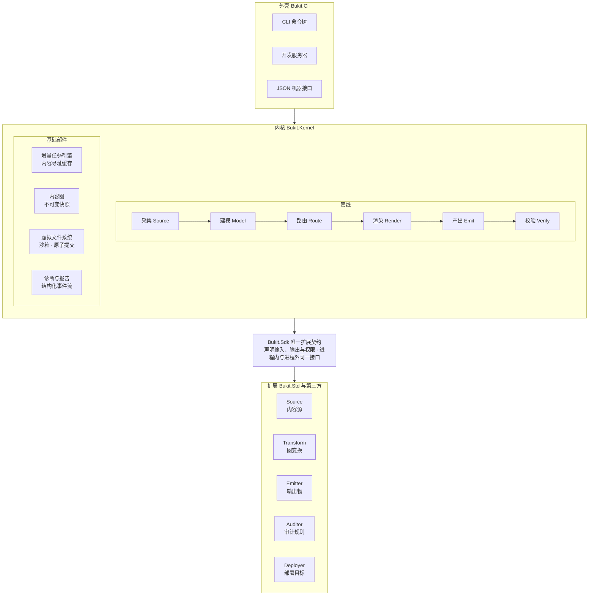
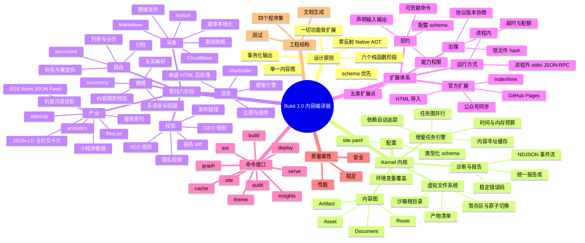

# Bukit 3.0 重构设计方案

状态：设计稿，尚未实现。日期：2026-11-24。

## 背景

目标：从零设计 Bukit 3.0，要求性能更好、更稳定、代码量更小、扩展性完善、命令接口更详细、结构简单。

约束：只以功能点清单为输入，不参考现有架构、模式和代码；允许破坏性变更（配置、命令、插件协议、输出路径都可以改）。

## 核心定位

Bukit 3.0 是一个内容编译器：输入内容源和主题，输出一个经过校验的静态站点。
整个系统只有一个数据模型（内容图）和一条管线（六个阶段），其余全部是扩展。

## 最高指导方针

以性能为终极驱动力；以大道至简、三思而行、行而必果为设计方针与行事风格。本文其余内容都服从这一节。

| 方针 | 在设计中的含义 | 在执行中的含义 |
|---|---|---|
| 性能为终极驱动力 | 每个结构选择都要回答“它让构建更快还是更慢” | 性能结论只认测量结果，不认推测 |
| 大道至简 | 一个模型、一条管线、一套契约；能删的部件就删 | 加入一个部件之前，先确认不能靠删除或合并解决 |
| 三思而行 | 先定性能预算和验证方法，再定结构 | 动工前写清影响范围、验证方式和回退办法 |
| 行而必果 | 每个阶段都有可判定的完成标准 | 开始的工作做到验证通过为止，如实报告结果 |

取舍规则：

1. 简单与性能一致时（多数情况），选最简单的方案。
2. 两者冲突时，性能优先，但必须有基准测量证明差距；没有测量就按最简单的做。
3. 任何进入内核的部件都要附带基准；没有基准的优化不合入。

## 性能设计

### 性能预算

先建立固定的基准站点和 2.0 基线，再写入阈值；本稿不预设未经测量的数字。

| 指标 | 测量方式 |
|---|---|
| 冷构建耗时 | 基准站点，空缓存，完整构建 |
| 增量构建耗时 | 修改单个内容文件后重建 |
| 启动耗时 | `bukit --version` 和 `bukit site check` |
| 内存峰值 | 冷构建过程中的最大常驻内存 |
| 二进制体积 | Native AOT 单文件大小 |

任一指标相对已记录基线退化，即阻止合入。

### 热路径规则

热路径指“读取内容 → 建模 → 渲染 → 写出”这条逐页执行的路径。

1. 热路径只在进程内执行。进程外扩展只能按批次调用（整个内容源、整个构建后处理），不能逐页调用。
2. 全程 UTF-8：读入字节、解析、渲染、写出都不转成 UTF-16 字符串。
3. 快照冻结而不复制：内容图用追加式的列式表和整数 ID 存储，阶段结束时冻结，下一阶段只读。
4. 缓存键用快速的非加密 hash，并先用文件大小和修改时间预筛；加密 hash 只用于扩展锁文件校验。
5. 模板只编译一次，编译结果只读共享；HTML 后处理单遍完成。
6. 并行由任务图决定，并行度有上限；输出写入批量提交。
7. 启动零反射，只加载配置里用到的扩展。

## 架构图

## 思维导图

## 设计原则

1. 单一内容图：Document、Route、Asset、Artifact 四种节点，每个阶段结束时冻结快照（冻结而不复制）。
2. 纯函数阶段：阶段之间只通过快照传递数据，没有共享可变状态。
3. 一切功能皆扩展：内置功能和第三方功能使用同一套公开契约，没有特权通道。
4. 事务化输出：先写暂存区，全部成功后原子切换；失败时旧输出原样保留。
5. schema 优先：配置、扩展配置、报告格式都由 schema 定义，文档和校验由 schema 生成。
6. 零反射：全部序列化和注册使用源生成，保证 Native AOT 体积和启动速度。

## 分层

| 层 | 程序集 | 职责 |
|---|---|---|
| 外壳 | `Bukit.Cli` | 命令树、开发服务器、`--json` 机器接口 |
| 内核 | `Bukit.Kernel` | 内容图、增量任务引擎、虚拟文件系统、配置、诊断与报告 |
| 契约 | `Bukit.Sdk` | 五类扩展点接口、能力声明、进程外协议定义 |
| 标准库 | `Bukit.Std` | 全部内置扩展（内容源、变换、输出物、审计规则、部署目标） |

依赖方向只有一条：`Cli → Kernel → Sdk ← Std`。扩展只能引用 `Bukit.Sdk`。

## 管线六阶段

| 阶段 | 输入 → 输出 | 承载的功能点 |
|---|---|---|
| 采集 Source | 配置 → 原始文档 | Markdown、Notion、CloudBase、数据文件、媒体本地化、离线快照 |
| 建模 Model | 原始文档 → 规范文档 | 内容模型校验、多语言与回退、taxonomy、关系解析、排序 |
| 路由 Route | 规范文档 → 路由表 | permalink、列表与分页、归档、别名与重定向、路由安全 |
| 渲染 Render | 路由表 → HTML | 模板引擎、主题与组件、shortcode、单遍 HTML 后处理（SEO 头、analytics、链接改写一次完成） |
| 产出 Emit | 路由表 → 附属产物 | sitemap、feed、搜索索引、llms.txt、JSON-LD、机器可读投影、小程序数据 |
| 校验 Verify | 全部产物 → 报告 | SEO、GEO、发布就绪、隐私规则，报告 diff |

## 内核部件

- 增量任务引擎：每个任务声明输入，引擎记录依赖并按内容 hash 缓存；并行度和执行顺序由任务图决定。开发服务器不是另一套实现，只是把文件变更变成缓存失效。
- 虚拟文件系统：所有读写都经过沙箱根目录检查；输出由产物清单记录归属，`clean` 按清单删除。
- 诊断与报告：所有阶段写同一条结构化事件流（稳定错误码、位置、建议）；审计就是在事件流和产物图上跑规则，SEO、GEO、发布审计共用一个报告库和一个 diff 实现。

## 扩展契约

五类扩展点：`Source`、`Transform`、`Emitter`、`Auditor`、`Deployer`。每个扩展声明：

- 读取和产出的节点类型（引擎据此调度和缓存）
- 配置 schema（并入 `site.yaml` 的校验和文档）
- 所需能力：文件路径、网络域名、环境变量（未声明即拒绝）
- 可选：贡献的子命令

运行方式两种，接口相同：进程内（内置和受信扩展），进程外（stdio JSON-RPC，带锁文件 hash、超时和配额）。进程外扩展只能按批次调用，不进入逐页热路径。

## 命令接口

统一为“名词 动词”，所有命令支持 `--json` 和稳定退出码。

| 命令 | 子命令 / 主要选项 |
|---|---|
| `bukit site` | `new`、`check`、`doctor`、`schema` |
| `bukit build` | `--watch`、`--jobs`、`--draft`、`--clean`、`--explain` |
| `bukit serve` | `dev`、`static`，`--host`、`--port`、`--allow-lan` |
| `bukit audit` | `run`、`diff`、`explain <code>`，`--set seo,geo,publish,privacy` |
| `bukit insights` | `search`、`questions`、`generative`、`authority` |
| `bukit deploy` | `plan`、`apply`、`status` |
| `bukit ext` | `list`、`add`、`remove`、`verify`、`run` |
| `bukit graph` | `routes`、`deps`、`why <route>` |
| `bukit cache` | `status`、`clean` |
| `bukit theme` | `check`、`scaffold` |

全局选项：`--json`、`--config`、`--log-format`、`--secrets-stdin`。帮助、补全、CLI 文档由同一份命令树声明生成。

## 质量属性

- 性能：见“性能设计”一节；内容寻址增量、任务图并行、模板预编译、缓冲池流式写出、源生成序列化。
- 稳定：失败不留半成品、阶段无共享可变状态、错误不跨界抛出、中断后可重跑。
- 安全：能力沙箱、SSRF 防护、密钥脱敏、symlink 边界、下载预算。

## 已采用的推荐决策

1. 技术栈：继续 .NET Native AOT。
2. 模板语言：保持 Scriban 语法兼容；模板引擎放在端口后面，是否自研渲染器由渲染阶段的基准结果决定。
3. 迁移策略：提供一次性的 `site.yaml` 和主题迁移工具，3.0 内不保留兼容层。

## 待定事项

- 3.0 代码的存放位置：本仓库的新分支加新顶层目录，或新仓库。

## 实施顺序

0. 基准站点、基准工具和 2.0 基线；写入性能预算阈值。
1. `Bukit.Sdk` 契约和 `Bukit.Kernel`（内容图、任务引擎、虚拟文件系统、诊断）。
2. 最小闭环：Markdown 源 → 路由 → 渲染 → HTML 输出，加 `site`、`build`、`serve`。
3. 逐个把功能点实现为 `Bukit.Std` 扩展：产出类 → 审计类 → Notion、CloudBase → 部署。
4. 进程外扩展协议和官方扩展（HTML 导入、IndexNow、公众号同步）。
5. 迁移工具和文档生成。

## 验证方式

- 确定性测试：同一输入构建两次，输出逐字节一致。
- 阶段黄金测试：每个阶段用固定快照做输入，对比输出快照。
- 扩展契约测试：同一组测试对进程内和进程外扩展各跑一遍。
- 性能基准：冷构建、单文件修改后的增量构建、内存峰值，对比 2.0 同一站点。
- 故障注入：在暂存写入阶段中断进程，确认旧输出完好且可重跑。
