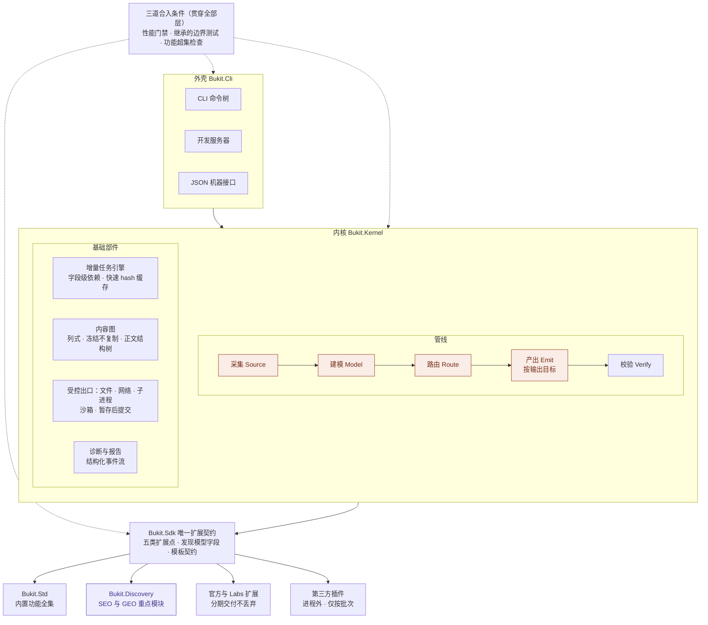
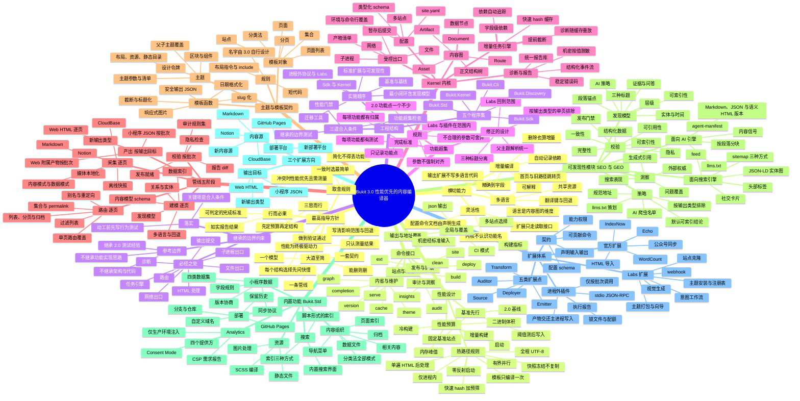

# Bukit 3.0 重构设计方案

状态：设计稿，尚未实现。日期：2026-11-24。

## 背景

目标：从零设计 Bukit 3.0，要求性能更好、更稳定、代码量更小、扩展性完善、命令接口更详细、结构简单。

约束：

- 输入只有两样：2.0 的功能点（用户能做到的事），以及 2.0 测试里沉淀的边界情况。
- 不参考、不引用、也不考虑 2.0 的代码实现、架构和业务逻辑。
- 不对齐参数：名称、选项、配置项由 3.0 重新设计，2.0 里不合理的参数可以舍弃，只要背后的功能仍然做得到。
- 必须继承 2.0 的测试经验，重写时不重新踩一遍；化繁为简不得降低质量或引入新问题。
- 3.0 的功能必须是 2.0 的超集，2.0 的任何一个功能点都不能遗漏。
- 允许破坏性变更（配置、命令、插件协议、输出路径都可以改），但功能必须保留。

## 核心定位

Bukit 3.0 是一个内容编译器：输入内容源和主题，输出一个经过校验的静态站点。
整个系统只有一个数据模型（内容图）和一条管线（五个阶段），其余全部是扩展。

## 最高指导方针

以性能为终极驱动力；以大道至简、三思而行、行而必果为设计方针与行事风格。本文其余内容都服从这一节。

| 方针 | 在设计中的含义 | 在执行中的含义 |
|---|---|---|
| 性能为终极驱动力 | 每个结构选择都要回答“它让构建更快还是更慢” | 性能结论只认测量结果，不认推测 |
| 大道至简 | 一个模型、一条管线、一套契约；能删的部件就删 | 加入一个部件之前，先确认不能靠删除或合并解决 |
| 三思而行 | 先定性能预算和验证方法，再定结构 | 动工前写清影响范围、验证方式和回退办法 |
| 行而必果 | 每个阶段都有可判定的完成标准 | 开始的工作做到验证通过为止，如实报告结果 |

取舍规则：

1. 简单与性能一致时（多数情况），选最简单的方案。
2. 两者冲突时，性能优先，但必须有基准测量证明差距；没有测量就按最简单的做。
3. 任何进入内核的部件都要附带基准；没有基准的优化不合入。

## 性能设计

### 性能预算

先建立固定的基准站点和 2.0 基线，再写入阈值；本稿不预设未经测量的数字。

| 指标 | 测量方式 |
|---|---|
| 冷构建耗时 | 基准站点，空缓存，完整构建 |
| 增量构建耗时 | 修改单个内容文件后重建 |
| 启动耗时 | `bukit --version` 和 `bukit site check` |
| 内存峰值 | 冷构建过程中的最大常驻内存 |
| 二进制体积 | Native AOT 单文件大小 |

任一指标相对已记录基线退化，即阻止合入。

### 热路径规则

热路径指“读取内容 → 建模 → HTML 输出 → 写出”这条逐页执行的路径。

1. 热路径只在进程内执行。进程外扩展只能按批次调用（整个内容源、整个构建后处理），不能逐页调用。
2. 全程 UTF-8：读入字节、解析、渲染、写出都不转成 UTF-16 字符串。
3. 快照冻结而不复制：内容图用追加式的列式表和整数 ID 存储，阶段结束时冻结，下一阶段只读。
4. 缓存键用快速的非加密 hash，并先用文件大小和修改时间预筛；加密 hash 只用于扩展锁文件校验。
5. 模板只编译一次，编译结果只读共享；HTML 后处理单遍完成。
6. 并行由任务图决定，并行度有上限；输出写入批量提交。
7. 启动零反射，只加载配置里用到的扩展。

## 架构图



图例：橙色阶段含逐页执行的热路径（产出阶段中只有 HTML 输出逐页执行，其余输出按批次），校验阶段按批次执行；紫色是重点模块；底部是三道合入条件。

## 思维导图



## 设计原则

1. 单一内容图：Document、Route、Asset、Artifact 四种节点，每个阶段结束时冻结快照（冻结而不复制）。
2. 纯函数阶段：阶段之间只通过快照传递数据，没有共享可变状态。
3. 一切功能皆扩展：内置功能和第三方功能使用同一套公开契约，没有特权通道。
4. 事务化输出：先写暂存区，全部成功后再提交到正式目录；提交前失败时旧输出原样保留。提交是逐目录交换，不是跨目录的原子操作，见“输出提交的保证范围”。
5. schema 优先：配置、扩展配置、报告格式都由 schema 定义，文档和校验由 schema 生成。
6. 零反射：全部序列化和注册使用源生成，保证 Native AOT 体积和启动速度。

## 分层

| 层 | 程序集 | 职责 |
|---|---|---|
| 外壳 | `Bukit.Cli` | 命令树、开发服务器、`--json` 机器接口 |
| 内核 | `Bukit.Kernel` | 内容图、增量任务引擎、虚拟文件系统、配置、诊断与报告 |
| 契约 | `Bukit.Sdk` | 五类扩展点接口、能力声明、进程外协议定义 |
| 标准库 | `Bukit.Std` | 内置扩展（内容源、变换、输出物、部署目标），不含 SEO 与 GEO |
| 可发现性 | `Bukit.Discovery` | SEO 与 GEO：发现模型、策略、两类表达、审计规则、洞察 |

依赖方向只有一条：`Cli → Kernel → Sdk ← Std`，`Bukit.Discovery` 与 `Bukit.Std` 并列，同样只依赖 `Bukit.Sdk`。发现模型的字段定义放在 `Bukit.Sdk` 里。扩展只能引用 `Bukit.Sdk`。

## 管线五阶段

| 阶段 | 输入 → 输出 | 承载的功能点 |
|---|---|---|
| 采集 Source | 配置 → 原始文档 | Markdown、Notion、CloudBase、数据文件、媒体本地化、离线快照 |
| 建模 Model | 原始文档 → 规范文档 | 内容模型校验、多语言与回退、taxonomy、关系解析、排序 |
| 路由 Route | 规范文档 → 路由表 | permalink、列表与分页、归档、别名与重定向、路由安全 |
| 产出 Emit | 路由表 → 各输出目标的产物 | 按输出目标执行。Web：模板引擎、主题与组件、shortcode、单遍 HTML 后处理（SEO 头、analytics、链接改写一次完成）、sitemap、feed、搜索索引、llms.txt、JSON-LD、机器可读投影。小程序：JSON 数据集 |
| 校验 Verify | 全部产物 → 报告 | SEO、GEO、发布就绪、隐私规则，报告 diff |

## 内核部件

- 增量任务引擎：每个任务声明输入，引擎记录依赖并按内容 hash 缓存；并行度和执行顺序由任务图决定。开发服务器不是另一套实现，只是把文件变更变成缓存失效。
- 受控出口（文件、网络、子进程）：扩展和内核自身都只能经这三个出口接触外界，边界情况在出口处统一处理，见“从 2.0 测试继承的边界约束”。
- 虚拟文件系统（文件出口）：所有读写都经过沙箱根目录检查；输出由产物清单记录归属，`clean` 按清单删除。
- 诊断与报告：所有阶段写同一条结构化事件流（稳定错误码、位置、建议）；审计就是在事件流和产物图上跑规则，SEO、GEO、发布审计共用一个报告库和一个 diff 实现。

### 输出提交的保证范围

- 保证：提交开始前的任何失败都不改动正式输出目录。
- 不保证：多个目录（多个输出目标、缓存）之间的原子切换。提交过程中读者可能短暂看到某个目录缺失，或看到新旧目录并存。
- 不保证：进程在提交中途崩溃后自动回到旧状态。
- 应对：提交步骤写入日志，下次构建检测到未完成的提交时恢复或要求清理重建；单个目录的交换在同一文件系统上用重命名完成；部署只接受已完成提交的构建。
- 各平台的重命名语义不同，需要分别验证。

## 扩展契约

五类扩展点：`Source`、`Transform`、`Emitter`、`Auditor`、`Deployer`。每个扩展声明：

- 读取和产出的节点类型（引擎据此调度和缓存）
- 配置 schema（并入 `site.yaml` 的校验和文档）
- 所需能力：文件路径、网络域名、环境变量（未声明即拒绝）
- 可选：贡献的子命令

运行方式两种，接口相同：进程内（编进二进制的内置扩展），进程外（stdio JSON-RPC，带锁文件 hash、超时和配额）。Native AOT 不支持运行时加载程序集，所以第三方扩展只能是进程外的。进程外扩展只能按批次调用，不进入逐页热路径。

## 三个扩展方向

内容源、输出目标、部署平台都接在同一张平台无关的内容图上。新增 N 个内容源、M 种输出、K 个部署平台，工作量是 N+M+K，不是它们的乘积；三个方向新增时内核都不改。


虚线框是未来新增的位置。部署平台目前只有 GitHub Pages；小程序数据部署到哪里，本稿不预设。

### 内容源

- 每个内容源是一个 `Source` 扩展，只负责把外部数据变成内容图里的文档节点。
- 新增方式：实现一个接口，附带配置 schema，在 `site.yaml` 的 `sources` 里加一项。
- 各内容源并行拉取；每个源返回修订标记，未变化时直接用缓存。

### 输出目标

- Web HTML 和小程序 JSON 地位相同，都是一个输出目标；HTML 不再是管线里的固定阶段，而是内置的、走热路径的 `Emitter`。
- 每个输出目标有自己的一组 `Emitter`、自己的输出目录和自己绑定的部署平台。
- 路由表为每个输出目标记录各自的地址：网页是 URL 路径，小程序是数据集键。
- 各目标共用同一张内容图，内容只采集和建模一次；`bukit build --target <name>` 只构建指定目标。
- 正文存为平台无关的结构树（段落、标题、图片、列表等），由各输出目标自行渲染：HTML 目标渲染成网页，小程序目标转成 `rich-text` 节点。非网页目标不需要反向解析 HTML。

### 部署平台

- 每个部署平台是一个 `Deployer` 扩展，输入是产物清单（文件路径和内容 hash），不关心产物如何生成。
- 新增方式：实现“计划、执行、查询状态”三个操作，对应 `bukit deploy plan / apply / status`。
- 按清单里的 hash 只上传有变化的文件。

### 配置示意

```yaml
sources:
  - type: notion
  - type: markdown
targets:
  web:
    emit: [html, sitemap, feed, search]
    deploy: github-pages
  miniprogram:
    emit: [dataset-json]
    deploy: <deployer-name>
```

## 重点模块：可发现性（SEO 与 GEO）

SEO 和 GEO 是 3.0 的重点功能，由独立的可发现性模块负责，完整设计见 [可发现性模块设计](2026-11-24-bukit-3.0-seo-geo-module.zh-CN.md)。

- 发现模型：每条路由一份关于“这页是什么”的事实，所有输出和审计只读这一份。
- 策略：可索引性、规范地址、标题、AI 爬虫、`llms.txt` 策划，每类决定只有一个判定，输出结论和理由。
- 表达：面向搜索引擎（头部标签、JSON-LD 实体图、sitemap、feed）和面向 AI 引擎（`llms.txt`、每页的 Markdown 与 JSON 版本、按段落分块、清单）。
- 校验：六类规则，可作为发布门禁。
- 洞察：用外部观测数据检验效果，结论回到内容和策略。

模块仍只通过五类扩展点接入，内核不为它开特权通道。它能保证正确、一致、可校验、可度量，不能保证排名或被 AI 引用。

## 功能超集

3.0 的功能必须是 2.0 的超集。功能清单与归属见 [功能超集对照](2026-11-24-bukit-3.0-feature-parity.zh-CN.md)。

超集指功能，不指参数：3.0 只记录 2.0 的功能点，不参考 2.0 的代码实现、架构和业务逻辑，也不要求参数对齐。名称和选项由 3.0 重新设计，2.0 里不合理的参数可以舍弃。

对 2.0 用户文档的盘点发现，下列整块功能此前没有写进设计，现在明确归属：

| 能力 | 归属 |
|---|---|
| 导航菜单、相关内容、页面索引、分类法的全部模式、归档、数据文件 | `Bukit.Std` |
| 搜索索引的三种方式、脚本形式的索引、内置搜索界面 | `Bukit.Std` |
| 图片处理（响应式尺寸、WebP）、SCSS 编译 | `Bukit.Std`，经子进程出口或内置编码 |
| Analytics（四个提供方、Consent Mode、CSP 需求报告、仅生产环境注入） | `Bukit.Std`，并入 HTML 单遍后处理 |
| 小程序数据的全部数据集种类、字段规则、版本协商与同步协议 | 小程序输出目标 |
| 数据模式的内容源与数据索引 | 建模阶段 |
| 内容模型 schema 的全部约束 | 建模阶段 |
| 模板能读到的数据和能调用的函数 | 模板契约，名字由 3.0 自行设计 |
| 一个仓库多个站点、调用级覆盖、CI 模式、构建指标输出 | 命令接口 |
| Labs 与官方插件的全部功能 | 贡献命令的扩展，分期交付 |

两处为简化而丢失能力的设计已经修正：可索引性改为“默认结论加按输出类型的单页排除”；标题改为保留内容标题、SEO 标题、最终文档标题三种。

某个部件动工之前，它负责的功能必须都已列入功能清单并各有测试。这是合入条件，与继承测试、性能门禁并列。

## 灵活性约束

目标：面对新需求时只改或只加很少的代码。靠三条约束实现：

1. 内核不认识任何功能名。内核只有内容图、任务引擎、文件系统和诊断；新功能是一个新扩展，读已有节点，产出新节点或产物。
2. 扩展只能通过内核提供的读取接口拿数据。依赖追踪和增量编译由此自动获得，扩展不为此写代码。
3. 配置、命令、文档由声明生成。扩展声明配置 schema 和子命令，校验、帮助、补全、文档自动跟上。

限度：新需求要求内容图增加一种新的节点类型时，必须改内核。

## 多语言

语言是内容图的一个维度，不由各功能分别处理。

- 建模阶段：每篇文档带语言标记，同一内容的各语言版本通过翻译键关联；缺译时的回退规则在这一阶段算完。
- 路由阶段：默认语言放根目录还是带前缀，是一条布局策略，只在这一阶段出现一次。
- 产出阶段：每条路由自带语言字段，sitemap、feed、搜索、hreflang 按该字段分组。输出扩展不写多语言代码，新增输出时多语言自动生效。
- 新增一种语言：配置里加一项并提供内容。各语言作为独立任务并行构建，修改一种语言的内容只重建该语言的页面。

## 增量编译

增量是任务引擎的工作方式，不是单独的功能。

- 自动记录依赖：任务通过读取接口拿数据，引擎记下它读了哪些文件、哪些节点的哪些字段、哪些模板。
- 精确到字段：修改一篇文章的标题，只重建该文章和读过其标题的列表页；修改正文，列表页不重建。
- 提前截断：任务重跑后输出未变，下游不再重跑。
- 删除：对比前后两次的产物清单，清除不再有归属的输出文件。
- 可解释：`bukit build --explain` 和 `bukit graph why <route>` 说明某一页为什么被重建。
- 整体失效：内核版本、扩展版本或相关配置片段变化时，对应缓存整体失效。
- 网络数据：内容源必须给出修订标记，引擎据此判断是否变化。

## 外部插件

外部插件是独立的可执行文件，可用任何语言编写，通过 stdio JSON-RPC 与主进程通信，可实现五类扩展点中的任意几类。

- 清单：声明版本、协议版本、提供的扩展点、配置 schema、所需权限和贡献的子命令。
- 锁定：`bukit ext add` 把插件 hash 写入锁文件，`bukit ext verify` 校验；hash 不符即拒绝运行。
- 隔离：插件不直接写输出目录，产物交还主进程写入，沙箱和暂存提交对插件同样生效。超时、内存超限、崩溃只产生诊断，不影响主进程。
- 增量：主进程按“输入切片的 hash 加插件 hash”缓存插件输出，输入未变时不启动插件进程。
- 限制：外部插件只能按批次调用，不能进入逐页热路径；需要逐页定制 HTML 的插件只能做成构建后的批处理。

## 从 2.0 测试继承的边界约束

来源：对 2.0 测试的只读梳理，完整清单见 [继承的边界情况清单](2026-11-24-bukit-3.0-inherited-edge-cases.zh-CN.md)。每条都写成“给定某种情况，系统必须怎样”的行为要求，以 2.0 的测试文件为证据，不带 2.0 的实现方式。

| 范围 | 条数 | 关键 | 重要 | 次要 |
|---|---|---|---|---|
| 引擎、路由、渲染、主题、磁盘写满 | 162 | 40 | 92 | 30 |
| 命令行、配置、内容源、部署、外部插件 | 148 | 32 | 88 | 28 |
| 功能插件、审计与洞察、Notion 细节、导入与同步、Windows | 199 | 27 | 125 | 47 |
| 剩余测试：集成场景、SEO 模型、磁盘写满、Labs、搜索观测、发布流程、HTML 导入版式 | 91 | 8 | 52 | 31 |
| 合计 | 600 | 107 | 357 | 136 |

“关键”指重写时踩到会丢数据、泄露机密、越权读写或发布错误内容。

### 化繁为简的做法

边界情况不分散到各功能里处理，而是收拢到少数几个必经之处。扩展拿不到原始的文件、网络和进程接口，因此不可能绕过这些规则；每条规则只实现一次、只测一次。

| 必经之处 | 在这里统一处理的边界情况 |
|---|---|
| 文件出口 | 覆盖或删除只认上一轮产物清单里登记、且字节未变的文件，插件派生的输出也记在同一本账上；“本工具生成的文件”与“发布根里已有的文件”分开记录；清理只删带自己标记的目录，拒绝项目根、主目录、版本库目录和经符号链接到达的目标；源目录与输出目录按物理身份判断重叠；默认不穿过目录符号链接；校验后从同一句柄读取，不按路径重新打开；目标冲突按输出卷实际的大小写敏感性判断；Windows 保留名在所有平台拒绝；敏感点文件不发布；未本地化的签名地址不进入任何产物；报告写在发布根之外 |
| 输出提交 | 任一阶段失败、取消、磁盘写满时正式输出不变；提交中途崩溃后按记录恢复，备份缺失或目标被改动时停止并交给人工，不猜测 |
| 外部输入 | 外部数据文件经同一个有界入口读取：拒绝远程和网络路径，限制大小和行数，拒绝重复键和未知字段，错误用稳定错误码且不回显路径；输入身份按规范化后的真实路径判断，输出与任一输入是同一文件时拒绝 |
| 公开投影 | 原始文档变成公开内容的唯一出口：内部标识（页面 ID、用户 ID、工作区链接）映射成站内地址或公开名称，否则丢弃并诊断；隐私类问题不允许以告警放行；校验阶段的扫描只作兜底 |
| 网络出口 | 拒绝内网、回环和云元数据地址（媒体下载可在配置里显式关闭私网拦截，关闭时每次构建都告警）；不自动跟随重定向，每一跳重新校验；认证头只发往规范主机；分页设请求预算并防重复游标；下载内容按文件签名校验并受大小预算约束；主题注册表等安装包必须带合法 SHA-256，解压前校验，缺失或不匹配即拒绝 |
| 子进程出口 | 不继承宿主环境变量，只传显式授权的变量；超时或取消时终止整棵进程树；输出读取有界，不因管道灌满而死锁 |
| 诊断 | 机密按值脱敏，最长优先；列出环境变量时再按键名打码，未授权但敏感的键也不显示；错误信息不回显用户输入和响应正文；日志里的 URL 只保留协议、主机和端口 |
| 任务引擎 | 增量结果与全量构建逐字节一致；失效基于内容而非长度和时间戳；缓存损坏或哈希超预算时保守地全量重建；并行与串行输出一致 |
| 路由 | URL 和输出路径拒绝遍历、编码的斜杠和控制字符，变换后再校验一次；带点的最后一段只有网页类扩展名才算文件；默认语言在根目录时语言代码是保留的首段 |
| HTML 处理 | 基于词法扫描而非正则；忽略注释和脚本里形似标签的文字；没有 `<head>` 时原样返回；重复执行结果不变；内嵌脚本的 JSON 转义到无法提前闭合 |
| 配置 | 未声明字段报错；多文档拒绝；显式空值不等于未设置；所有路径字段拒绝遍历和绝对路径；枚举值按精确值匹配；共享资源前缀与媒体前缀不得互相包含；文件名段不超过 255 个 UTF-8 字节，超出报错不截断；Windows 设备名只用一套规则，覆盖路由、主题名和所有输出路径段，带扩展名的形式（`COM1.txt`）同样拒绝 |
| 内容源契约 | 元数据块非法时整次内容加载失败并点名该文件，不跳过、也不当作无元数据的文章发布；文件在读取元数据和正文之间变化时失败 |
| 排序与格式 | 排序用序数比较并有稳定的决胜键；数字和日期格式与区域设置无关；slug 对等价的 Unicode 写法给出相同结果 |
| 外部操作 | 不可重放的远端操作（创建草稿、发布）先持久化意图再调用；发布前一刻按最终载荷重新检查到期时间和字段上限；更新远端记录时显式为空与缺失分开处理；分页信息异常时停止破坏性操作；导入、克隆、推送等工具遇到与用户已有状态不一致（要改写用户配置、远端缺属性）时默认失败，只有显式开关才继续 |
| 内容值与校验 | 值类型区分数字原文、整数、浮点，以及日历日期和时间点；校验读冻结后的最终产物，输出缺失或截断时不连带报出派生问题 |

### 落实规则

1. 清单里的每一条在对应部件动工之前先写成 3.0 的行为测试；测试只断言可观察的行为，不照搬 2.0 的测试代码。
2. 107 条关键项是对应部件的合入条件。第三部分 U2、V1、V5、Y15 和第四部分 ZB9、ZC7、ZG1、ZG4、ZG5、ZI3、ZJ6、ZM1、ZM2、ZM15 记录的是 2.0 的反面行为，按条目里写的 3.0 行为实现。
3. 清单里出现的阈值和错误码只作参考，写入 3.0 规格前要回到证据测试核对。

### 清单的局限

- 600 条都已对照测试断言核对。第一、二部分原先只依据测试名的 253 条于 2026-11-24 补核：成立 203 条，修正 50 条，没有关键项方向错误。
- 测试目录已全部梳理过一遍。剩下的不确定性在于磁盘写满测试、Windows 虚拟磁盘脚本和发布脚本这类只读了代码、没看到运行结果的部分。2.0 也有完全没有测试的行为，如克隆内容的模板注入、安装归档的解压炸弹、webhook 请求体上限，见清单第四部分“未覆盖”。
- 补核发现 2.0 有几项要求只是测试名所说，断言并没有覆盖：sitemap 和 feed 的 XML 转义、文件名段的长度上限、“产物标记存在也不能绕过清理安全检查”。3.0 要为它们补上真正的测试。
- Windows 专属行为只核对了测试断言，运行结果在 GitHub Actions 的 Windows 运行器上，本次未查看。测试本身也有缺口：符号链接相关的保护在 Windows 上整体跳过，没有 junction 用例；进程树终止只有结构布局检查。3.0 的文件出口和子进程出口要补上在 Windows 上实际运行的行为测试。
- 2.0 的架构测试约束的是 2.0 自身的分层和公开接口，按“不参考 2.0 架构”的原则未继承。

### 已定的边界行为

第三部分梳理出几处值得商榷的 2.0 行为，2026-11-24 由用户按建议定下。3.0 按下面的规则实现，不继承 2.0 的做法。

1. 离线快照的查询条件与录制时不同：失败。查询条件纳入快照键。2.0 沿用旧页面并告警一次（S2）。
2. 已过期的内容：过期即下线，不再输出 HTML，也不进入任何清单。2.0 仍写出页面，只从各类索引中排除（T3）。
3. 导入时路由映射的 slug 重复：在写入前作为输入错误报出。2.0 静默保留第一条（Y15）。
4. 父主题：按名称从本地主题目录解析，拒绝路径形式和穿越；主题注册表是扩展提供的额外来源。2.0 按主题目录的兄弟目录解析（X14）。
5. 远端结构检查失败：默认失败，需要显式开关才允许跳过。2.0 告警后继续推送（Z11）。
6. 外部平台的字段上限：发布契约为每个字段声明计数单位（字符或 UTF-8 字节），并在最终载荷上校验（ZA3、ZA4）。

### 已定的边界行为（第四部分）

第四部分梳理出的八处行为，2026-11-24 由用户按建议定下。

1. hreflang 配对：内容只按显式翻译键配对，没有翻译键的内容不输出 hreflang；生成的路由（列表、分类词条、过滤列表、分页）按路由配对。2.0 在没有翻译键时按相同路由路径配对（ZB4）。
2. GEO 作者档案与文章作者冲突：诊断冲突、不发布无关的 Person，严格模式下失败。2.0 照样输出（ZC7）。
3. 列表页没有摘要：不回退到站点描述。2.0 的测试名与断言相反（ZC9）。
4. 搜索观测中查询串里的 `+`：按空格处理，与 `%20` 视为相同。2.0 按字面加号处理（ZK4）。
5. 路由 canonical 指向外部主机：不匹配本站观测，记为未匹配并给出原因。2.0 只看路径照样匹配（ZK5）。
6. 报告位置：报告放在发布根之外，构建的 JSON 输出给出各报告路径，消费者按这份路径读取。2.0 的消费者固定读产物目录下的 `.bukit/`（ZL4）。
7. 退出码：0 成功，1 一般失败或校验失败，2 参数或输入错误，3 模板或渲染错误；JSON 错误对象里的 exitCode 与进程退出码一致（ZL1）。
8. Labs 能力（clone、webhook、intent、data、visual，以及主题的注册表、安装、打包、向导等）属于 3.0 范围，以扩展形式分期交付，不丢弃；继承清单第四部分 ZG–ZJ 的边界同样适用。

### 已定的边界行为（补核）

逐条补核时发现的六处，2026-11-24 由用户按建议定下。

1. 私网拦截的关闭开关：保留，默认开启；关闭时每次构建都告警（K1）。
2. 枚举值：全部按精确值匹配，大小写或空格不同即拒绝（B13）。
3. 路径字段：所有路径字段都拒绝绝对路径和遍历（B7）。
4. 共享资源前缀与媒体前缀：两个方向的包含都拒绝（B10）。
5. 带变音符号的 slug：保持 2.0 的输出（“Résumé” 生成 `re-sume`），避免迁移后地址变化（N4）。
6. 文件名段：每段不超过 255 个 UTF-8 字节，超出时报错而不截断（#147）。

## 命令接口

统一为“名词 动词”，所有命令支持 `--json` 和稳定退出码：0 成功，1 一般失败或校验失败，2 参数或输入错误，3 模板或渲染错误。构建的 JSON 输出给出各报告的路径。2.0 Labs 的 clone、webhook、intent、data 和主题注册表不进首版。

| 命令 | 子命令 / 主要选项 |
|---|---|
| `bukit site` | `new`、`check`、`doctor`、`schema` |
| `bukit build` | `--target`、`--watch`、`--jobs`、`--draft`、`--clean`、`--explain` |
| `bukit serve` | `dev`、`static`，`--host`、`--port`、`--allow-lan` |
| `bukit audit` | `run`、`diff`、`explain <code>`，`--set seo,geo,publish,privacy` |
| `bukit insights` | `search`、`questions`、`generative`、`authority` |
| `bukit deploy` | `plan`、`apply`、`status`，`--target` |
| `bukit ext` | `list`、`add`、`remove`、`verify`、`run` |
| `bukit graph` | `routes`、`deps`、`why <route>` |
| `bukit cache` | `status`、`clean` |
| `bukit theme` | `check`、`scaffold` |

全局选项：`--json`、`--config`、`--site`、`--log-format`、`--secrets-stdin`。帮助、补全、CLI 文档由同一份命令树声明生成。

上表只列主要命令和选项。命令行必须具备的全部功能见 [功能超集对照](2026-11-24-bukit-3.0-feature-parity.zh-CN.md)；选项的名字由 3.0 自行设计，不要求与 2.0 相同。

## 质量属性

- 性能：见“性能设计”一节；内容寻址增量、任务图并行、模板预编译、缓冲池流式写出、源生成序列化。
- 稳定：提交前失败不改动正式输出、阶段无共享可变状态、错误不跨界抛出、中断后可重跑。
- 安全：能力沙箱、SSRF 防护、密钥脱敏、symlink 边界、下载预算。

## 已采用的推荐决策

1. 技术栈：继续 .NET Native AOT。
2. 模板语言：保持 Scriban 语法兼容；模板引擎放在端口后面，是否自研渲染器由 HTML 输出的基准结果决定。
3. 迁移策略：提供一次性的 `site.yaml` 和主题迁移工具，3.0 内不保留兼容层。
4. SEO 与 GEO 是重点功能，由独立的可发现性模块 `Bukit.Discovery` 负责；程序集共五个。

## 待定事项

- 3.0 代码的存放位置：本仓库的新分支加新顶层目录，或新仓库。

- 正文结构树的节点集合。它要求每个内容源都输出这种结构（Markdown 需要产出结构树的解析器），成本由基准测量评估。

## 实施顺序

0. 基准站点、基准工具和 2.0 基线；写入性能预算阈值。同时把继承清单里与第 1 步相关的条目写成行为测试。
1. `Bukit.Sdk` 契约和 `Bukit.Kernel`（内容图、任务引擎、虚拟文件系统、诊断）。
2. 最小闭环：Markdown 源 → 路由 → Web 输出目标（HTML），加 `site`、`build`、`serve`；同时包含可发现性模块的第一步（发现模型、可索引性与规范地址策略、头部标签、sitemap、`robots.txt`）。
3. 逐个把功能点实现为 `Bukit.Std` 扩展，并按可发现性模块自己的顺序推进 `Bukit.Discovery`：产出类 → 审计类 → Notion、CloudBase → 部署。
4. 进程外扩展协议和官方扩展（HTML 导入、IndexNow、公众号同步）。
5. 迁移工具和文档生成。

## 验证方式

- 继承测试：继承清单的每一条对应一个 3.0 行为测试，关键项全部通过才算部件完成。
- 功能超集检查：功能超集对照里的每项功能都有归属，并有至少一个测试证明它可用。
- 确定性测试：同一输入构建两次，输出逐字节一致。
- 阶段黄金测试：每个阶段用固定快照做输入，对比输出快照。
- 扩展契约测试：同一组测试对进程内和进程外扩展各跑一遍。
- 性能基准：冷构建、单文件修改后的增量构建、内存峰值，对比 2.0 同一站点。
- 专项测试自证：平台专属和破坏性测试（如磁盘写满）要能识别跳过、空跑和“假绿”，先确认环境安全再写入；降级类测试要断言字节不变、无归属登记、确实发出告警。
- 故障注入：在暂存写入阶段中断进程，确认旧输出完好且可重跑；在提交阶段中断进程，确认下次构建能检测到未完成的提交并恢复或要求清理重建。
