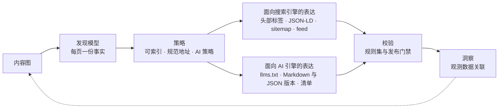

# Bukit 3.0 可发现性模块设计（SEO 与 GEO）

状态：设计稿，尚未实现。日期：2026-11-24。所属方案：[Bukit 3.0 重构设计方案](2026-11-24-bukit-3.0-architecture-design.zh-CN.md)。

## 定位

SEO 和 GEO 是 3.0 的重点功能，由一个专门的模块负责，称为“可发现性模块”。它的目标是让站点内容被搜索引擎和 AI 引擎正确地理解、收录和引用。

本模块服从总方案的最高指导方针：性能为终极驱动力，大道至简，三思而行，行而必果。

模块能保证的是正确、一致、可校验、可度量。它不能保证排名或被 AI 引用：这取决于外部引擎，而且 GEO 的做法仍在变化（例如 `llms.txt` 的采用程度并不确定）。因此模块里专门有“洞察”一环，用真实观测数据来检验做法是否有效。

## 模块结构

五个部分构成一个闭环：建模、决策、表达、校验、洞察，洞察的结论回到内容和策略。

| 部分 | 职责 | 所在阶段 |
|---|---|---|
| 发现模型 | 每条路由一份关于“这页是什么”的事实 | 建模、路由 |
| 策略 | 把配置和事实变成明确的决定，并给出理由 | 路由 |
| 表达 | 把同一份事实写成各引擎能读的形式 | 产出 |
| 校验 | 检查表达是否完整、一致、有效 | 校验 |
| 洞察 | 用外部观测数据检验效果，给出待办 | 构建之外 |

### 程序集

本模块单独成一个程序集 `Bukit.Discovery`，总方案的程序集从四个变为五个。理由是它是重点功能，需要独立的归属、测试和性能预算。它仍然只通过 `Bukit.Sdk` 的五类扩展点接入，内核不为它开特权通道。

发现模型的字段定义放在 `Bukit.Sdk` 里，作为内容图的标准记录。这样第三方内容源可以填写它，第三方输出目标可以读取它。

## 发现模型

每条路由一份，在建模和路由阶段算完后冻结，之后只读。

| 分组 | 内容 |
|---|---|
| 身份 | 规范地址、各语言版本、别名 |
| 描述 | 标题、描述、摘要、封面图及其尺寸 |
| 实体 | 页面类型、作者、组织、主题实体，以及它们之间的关系 |
| 时间 | 发布时间、修改时间、审阅时间 |
| 层级 | 面包屑、分类归属、上下篇 |
| 可索引性 | 结论和理由（草稿、过期、noindex、外部规范地址、重复） |
| 证据 | 引用来源、出处、数据日期 |
| 问答 | 从正文结构树提取的 FAQ、步骤、定义等可直接回答问题的片段 |
| 段落锚点 | 每个小节一个稳定的锚点，供引用和分块 |
| AI 策略 | 允许哪类 AI 用途（搜索、回答、训练），以及内容信号 |

所有表达和所有审计规则只读这一份。不存在第二份标题、第二份规范地址或第二个可索引性判断。

## 策略

每一类决定只有一个判定，输入是配置和发现模型，输出是结论加理由。理由会进入报告，`bukit audit explain` 和 `bukit graph why` 可以查到。

- 可索引性：这页是否进入 sitemap、feed、搜索索引、`llms.txt`。所有表达用同一个结论。
- 规范地址：自身、外部，或合并到另一页。
- 标题：模板、长度和宽度限制。
- AI 爬虫：按用途分类设定允许与否，写入 `robots.txt` 和内容信号。
- `llms.txt` 策划：选哪些内容、按什么顺序、给多少篇幅。

## 表达

全部是 `Emitter`，读发现模型，互不依赖。

### 面向搜索引擎

- 头部标签：标题、描述、规范地址、hreflang、robots、Open Graph、Twitter Cards。
- JSON-LD：每页一张实体图，实体有稳定的标识并互相引用（文章、作者、组织、面包屑、FAQ、HowTo），而不是几段互不相干的片段。
- 站点级：sitemap（含多语言和索引文件）、`robots.txt`、RSS、Atom、JSON Feed。

### 面向 AI 引擎

- `llms.txt` 和 `llms-full.txt`。
- 每页的 Markdown 版本和 JSON 版本，直接从正文结构树生成，带规范地址、时间和出处。
- 按段落锚点分块的内容，每块都能独立引用并指回来源。
- `agent-manifest.json`：每页有哪些机器可读版本、各自的地址。
- 页面里指向机器可读版本的链接，让 AI 代理能找到它们。

## 校验

审计规则是 `Auditor`，在最终产物和发现模型上运行。

| 规则类别 | 检查什么 |
|---|---|
| 完整性 | 必需的标题、描述、规范地址、时间、封面图是否齐全 |
| 一致性 | 网页、JSON-LD、Markdown、JSON、sitemap、feed 之间是否一致 |
| 可索引性 | 不该收录的页面没有出现在任何索引类输出里，反之亦然 |
| 结构化数据 | JSON-LD 的类型、必填属性和实体引用是否有效 |
| 可引用性 | 是否有稳定锚点、出处、日期，问答片段是否可独立成立 |
| 隐私 | 公开输出里没有内部标识和带签名的私有链接 |

- 每个问题有稳定的错误码、所在路由、理由和修复建议。
- 规则集：`seo`、`geo`、`publish`、`privacy`，由 `bukit audit run --set` 选择。
- 发布门禁：`bukit audit diff` 比较两次报告，可设“新增错误数上限”“可索引页面数不得下降”等条件，供 CI 使用。
- 扫描不完整时结论是“未通过”，不是“通过”。

## 洞察

把用户提供的本地观测文件和路由表关联，输出报告和待办。不联网，不在构建热路径上。

| 命令 | 输入 | 回答的问题 |
|---|---|---|
| `bukit insights search` | 搜索表现导出 | 哪些页面有曝光没点击，哪些该改标题和描述 |
| `bukit insights questions` | 目标问题清单和搜索问题观测 | 哪些问题还没有内容覆盖 |
| `bukit insights generative` | AI 回答的引用观测 | 哪些页面被 AI 引用，哪些没有 |
| `bukit insights authority` | 外部权威引用观测 | 哪些内容缺少外部佐证 |

洞察是闭环的最后一环：它检验前面的做法是否真的有效，结论回到内容和策略。

## 多语言和多输出目标

- 各语言版本的关系来自翻译键，hreflang 和各语言的站点级输出自动生成。
- 发现模型与输出目标无关。小程序等非网页目标可以读同一份模型，用自己的方式表达（例如分享标题和摘要）。

## 性能

- 头部标签和 JSON-LD 在 HTML 的单遍后处理里写入，不单独再扫一遍。
- 发现模型按页缓存；页面内容和相关配置不变时不重算。
- 单页规则的结果按页缓存；只有跨页规则（重复、一致性）每次重算。
- 站点级输出按批次生成，不进逐页热路径。
- 本模块有自己的性能预算项：审计耗时、站点级输出耗时。

## 扩展

| 需求 | 做法 |
|---|---|
| 新的结构化数据类型 | 加一个向实体图贡献节点的 `Emitter` |
| 新的审计规则 | 加一个 `Auditor` |
| 新的面向 AI 的格式 | 加一个 `Emitter` |
| 新的洞察类型 | 加一个贡献 `insights` 子命令的扩展 |
| 新的搜索或 AI 引擎约定 | 加一条策略或一个 `Emitter`，发现模型不变 |

限度：需要发现模型里没有的事实时，要先扩展发现模型的字段定义，这是对 `Bukit.Sdk` 的改动。

## 实施顺序

1. 发现模型、可索引性与规范地址策略、头部标签、sitemap、`robots.txt`。这一步并入总方案的“最小闭环”，不留到后面。
2. JSON-LD 实体图、feed、Open Graph 和 Twitter Cards。
3. 面向 AI 的表达：Markdown 与 JSON 版本、段落锚点、`llms.txt`、清单。
4. 审计规则集和发布门禁。
5. 洞察。

## 验证

- 每种表达有黄金测试：固定的发现模型输入，对比输出。
- 一致性测试：同一页的所有表达互相比对。
- 可索引性测试：对每种不可收录的原因，确认它不出现在任何索引类输出里。
- 结构化数据测试：实体引用闭合，必填属性齐全。
- 继承测试：2.0 的 SEO、GEO、审计和洞察相关测试的边界情况尚在梳理，完成后并入本模块的行为测试。

## 待定事项

- 发现模型的字段清单需要对照继承的边界情况定稿。
- 段落锚点的生成规则（稳定性与可读性的取舍）。
